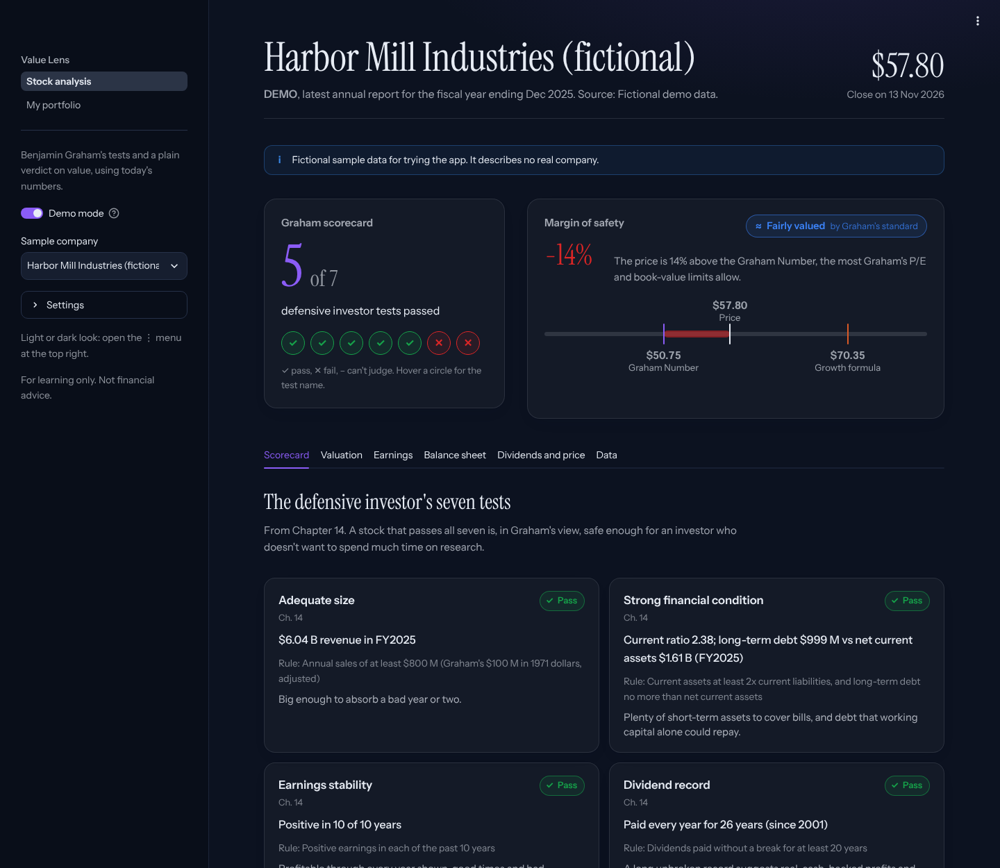
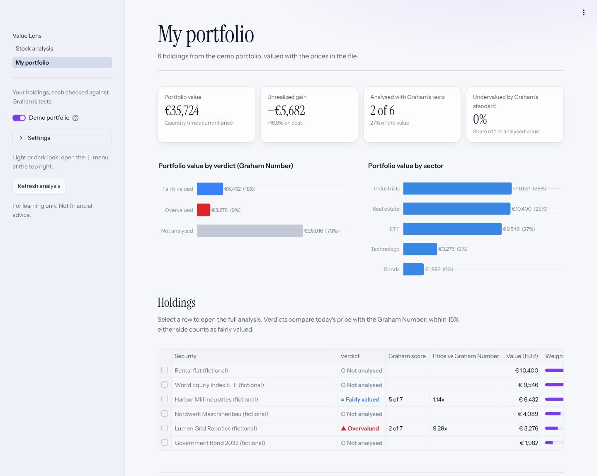

# Value Lens

Is a stock undervalued, fairly valued or overvalued? Value Lens answers with Benjamin Graham's tests from
*The Intelligent Investor* (revised 1973 edition), applied to today's numbers, and runs it across your whole
portfolio. Everything runs on your own computer: no account, no tracking, no analytics.



## What it does

**Stock analysis**
- **Seven defensive-investor tests** (Chapter 14): size, financial condition, earnings stability, dividend
  record, earnings growth, P/E and price-to-assets. Each shows the rule, the company's number and what the
  result means.
- **A plain verdict**: undervalued, fairly valued or overvalued, comparing the price with the Graham Number
  (within 15% either side counts as fair).
- **Honest about missing history.** If a test needs 10 years and only 5 exist, it still runs on the 5 and
  says so on the card.
- **Margin of safety**, the Chapter 11 growth formula, the net-net test and a recent-IPO flag (Chapter 6).
- **Charts** of EPS, P/E history, revenue and free cash flow, debt, current ratio, dividends and price.

**My portfolio**
- Reads your `Consolidated_Portfolio_Positions.csv` (read only, never copied into this project).
- Shows every holding with its value, gain, Graham score and verdict, plus value by verdict and by sector.
- Select a row to open that company's full analysis.
- Real estate, bonds, funds and anything without an ISIN are listed but not scored, with the reason shown.



Both pages have a **demo mode** with fictional data, so the app works without internet. Light and dark
themes are in the ⋮ menu at the top right.

## Run it locally

You need Python 3.10 or newer and Git.

```bash
git clone https://github.com/ShyamSundarVijayakumar/value-lens.git
cd value-lens
python -m venv .venv
# Windows:      .venv\Scripts\activate
# macOS/Linux:  source .venv/bin/activate
pip install -r requirements.txt
cp .env.example .env        # Windows: copy .env.example .env
# open .env: put your name and email in SEC_USER_AGENT,
# and optionally the path to your portfolio CSV in PORTFOLIO_CSV
streamlit run app.py
```

The app opens at http://localhost:8501. Try `KO`, `JNJ` or `MSFT`, or switch on demo mode.

Run the tests with `pytest`.

## Portfolio file

Expected columns (comma, semicolon or tab separated; `1234.56` and `1.234,56` both work):

`ISIN, Security Name, Last Bought Date, Current Quantity, Average Buy Price (EUR), Current Price (EUR),
Native Currency, Sector, Industry, Country, Unrealized PnL (EUR)`

Rows whose Sector is `real_estate`, `bonds`, `cash`, `commodities` or `crypto` are treated as non-stocks
(edit `NOT_STOCK_SECTORS` in `value_lens/portfolio/positions.py` to change this). ISINs are turned into
tickers with Yahoo Finance search; if one comes out wrong, fix it under **Fix tickers** on the portfolio page.
Your corrections are saved in `data/isin_tickers.csv`, which Git ignores.

## Where the data comes from

| Data | Source | Notes |
|---|---|---|
| Annual financial statements | [SEC EDGAR XBRL API](https://www.sec.gov/search-filings/edgar-application-programming-interfaces) | Free and official. SEC asks for a name and email in each request. History starts around 2009. |
| Prices, dividends, splits, ISIN search | Yahoo Finance via [yfinance](https://github.com/ranaroussi/yfinance) | Unofficial. Yahoo's data is for personal use, so each user downloads it on their own machine. |

Downloaded data is cached in `.cache/` (ignored by Git) and never committed.

## Limits

- Full analysis covers US companies that file 10-Ks with the SEC. Non-US holdings are listed as
  "Non-US company" until Europe support arrives.
- The Graham Number is strict: many good modern companies come out as overvalued by it.
- Banks and insurers don't report current assets, so the financial-condition test shows "Can't judge".
- XBRL tags vary between companies. The Data tab lists which tag fed each figure; check anything surprising
  against the 10-K itself.

## Roadmap

1. Europe: prices and dividends from yfinance, ESEF filings, manual entry for older years
2. Market valuation page: CAPE against each market's own history
3. India real estate: inflation-adjusted return calculator using CPI-IW

## Licence

Personal use by invitation only; see [LICENSE](LICENSE). Not financial advice.
